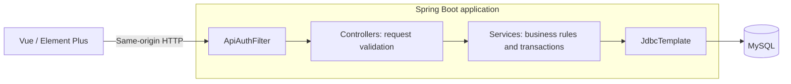

# Design and Interface Specifications

October 28, 2026 · [Back to README](../README.md) · [Requirements Baseline](SRS.md)

## Architecture

The system adopts a layered module structure within a Spring Boot application. The browser loads a same-origin static Vue page; ApiAuthFilter identifies the user from a Bearer token; the Controller receives and validates parameters; the Service enforces business rules, transactions, and permission checks; and the JdbcTemplate uses parameterized SQL to access MySQL.
This structure reuses existing pages and the existing Java/MySQL technical foundation, making it suitable for the current course scale. It does not rely on microservice deployment or separate front-end build tools.

## Key Design Decisions

- Customer ownership checks are included in database queries. This means that access control does not depend on hiding menu items in the browser.
- Orders and associated records use transactions; tasks first lock the order and then re-read the task to reduce duplicate completions and lock ordering conflicts.
- Inventory first locks the warehouse, then updates item stock, total usage, and transaction logs to prevent overselling and capacity overflows.
- Administrator changes acquire a database row lock on the settings record. This serializes changes and protects the last enabled administrator; batch role changes roll back if they fail.
- Image content is stored in the database to prevent file loss when temporary disks used in free deployments are lost after redeployment; this approach is suitable for course demos with size constraints and has not undergone large-scale storage evaluation.
- The front end retains a single-file structure and existing conventions; a shared request layer handles timeouts, errors, authentication, and responses to expired sessions.

## Data Model

The complete DDL is [02-schema.sql](../sql/02-schema.sql); the incremental update for the old database is [03-full-features.sql](../sql/03-full-features.sql).

| Table | Responsibilities and Primary Relationships |
|---|---|
| app_users | Accounts, password hashes, and roles |
| auth_tokens | Digests and expiration dates; associated with users |
| user_access | User activation and deactivation |
| logistics_orders | Shipping orders, owning users, fees, and status |
| order_traces | Tracking events associated with shipping orders |
| order_feedback | Up to one piece of feedback per shipment |
| logistics_tasks | Process steps and actual operators for shipments |
| task_vouchers | Task images and uploaders; primary keys are task_id and slot |
| warehouses | Warehouse capacity and usage |
| warehouse_stock | Unique inventory items composed of warehouses and items |
| inventory_records | Quantities, types, and operators for inventory in/out |
| system_settings | Singleton system configuration |
| notifications | User in-app notifications |

A user can have multiple orders; an order can have multiple tasks and tracking events, with a maximum of one feedback entry; a task can have multiple images. There is no direct foreign key relationship between inventory and orders.

## Status Model

| Current Status | Next Status Allowed by Staff |
|---|---|
| pending | transit, exception |
| transit | delivering, exception |
| delivering | delivered, exception |
| exception | transit, delivering |
| delivered / cancelled | none |

Customers can only change their own orders from “delivering” to “delivered” using a code. Each valid status change adds a tracking event; customer receipt confirmation completes the remaining tasks. The number of completed tasks equals the number of process steps, not the number of different orders.

## HTTP Contract

The root path is `/api`. All requests except POST login/register require `Authorization: Bearer <token>`.
Success is indicated by HTTP 200 and `{code:0,data:...,message:...}`; business failures typically result in HTTP 200 with a non-zero code. Missing, invalid, or expired bearer tokens result in HTTP 401; internal errors return HTTP 500. Incorrect login credentials are business failures, not HTTP 401 responses. Business messages are still in Chinese. Timestamps are in ISO 8601 format; fees and weight are JSON numbers.
Each row in the table below represents a method-path combination; there are 24 in total. The “20” count in the original reference contract was incorrect; there are actually 21, with 3 additional operations for account activation and system settings now provided.

| Method | Path | Permissions / Main Inputs |
|---|---|---|
| POST | /auth/register | Public; username, password, role |
| POST | /auth/login | Public; username, password |
| POST | /auth/logout | Logged-in users |
| GET | /orders | Customer's own orders; staff/administrators can access all orders; kw, status, page, size |
| POST | /orders | Customer; receiver, dest, goods, weight, fee |
| GET | /orders/{no} | Customer's own orders; staff/administrators can access all orders |
| POST | /orders/{no}/sign | Customer's own orders; code, by |
| POST | /orders/{no}/feedback | Customer's own orders; type, content |
| GET | /stats/overview | Logged-in users; customers see only their own orders, staff/administrators see global statistics |
| GET | /stats/weekly | Logged-in users; the meaning of the statistics depends on the role |
| GET | /stats/monthly | Administrators |
| GET | /tasks | Employees/Administrators; status, page, size |
| POST | /tasks/{id}/status | Employees; status, note |
| POST | /tasks/{id}/voucher | Employee; multipart files or files[], note |
| GET | /inventory | Employee/Administrator; type |
| POST | /inventory | Employee; type, goods, qty, wh |
| GET | /warehouses | Employee/Administrator |
| GET | /users | Administrator; kw, role, page, size |
| PATCH | /users/{id}/role | Administrator; role |
| POST | /users/batch-role | Administrator; role, ids |
| GET | /notifications | Logged-in user; notifications for the user |
| PATCH | /users/{id}/active | Administrator; active |
| GET | /settings | Logged-in user |
| PUT | /settings | Administrator; Complete settings object |

Login and registration return token, role, name, and account. Paginated lists return list and total; page starts at 1, with a default size of 10 and a maximum of 100. Order lists are sorted in reverse chronological order by creation time; orders with the same creation time are sorted by waybill number.
The settings object includes name, phone, notice, first, firstFee, addFee, signNtf, excNtf, and mktNtf. Registration roles are `customer` or `staff`. The `role` in the user list uses Chinese labels: `客户`, `物流员工`, `系统管理员`; role modifications are compatible with these labels and the internal English identifiers. Tasks include the compatible field `orderStatus`.
See [OrderModels.java](../src/main/java/com/example/logistics/order/OrderModels.java), [OperationsModels.java](../src/main/java/com/example/logistics/operations/OperationsModels.java), and [AuthController.java](../src/main/java/com/example/logistics/auth/AuthController.java). The retained [original API documentation](../reference/API_CONTRACT.md) is historical information and does not override the newly added interfaces.

## Deployment

The Render Docker service runs the application, and Aiven provides MySQL; the health endpoint `/health` checks whether the 13 tables are queryable. Configuration comes from environment variables; table creation is not performed automatically upon production startup. The startup script intended for a developer’s local machine is not a prerequisite for cross-machine installation. Please set up your own environment according to the README.
